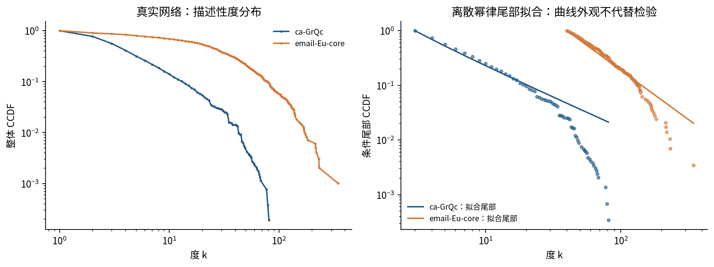
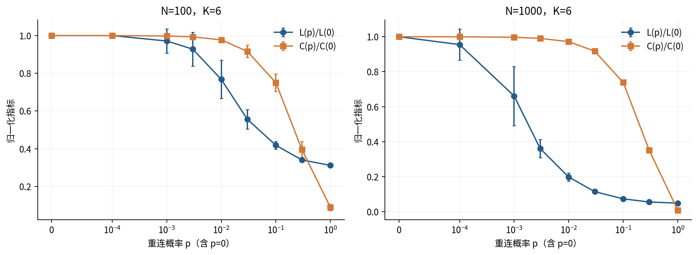
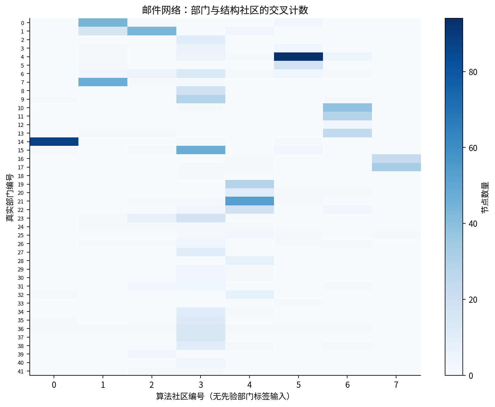
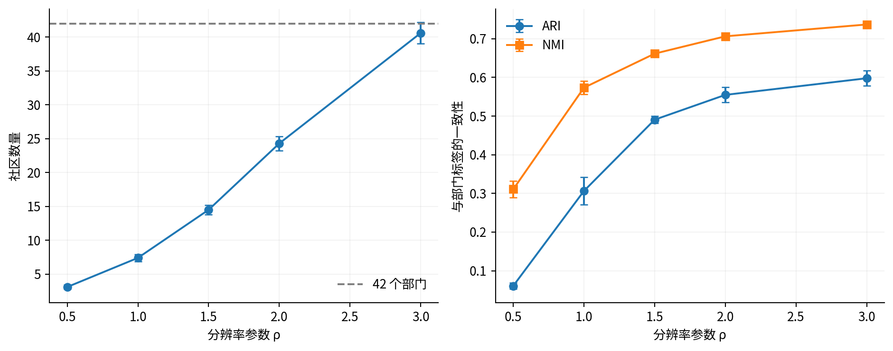

# 已保存结果

下列数值来自本仓库 CSV，不需要重新运行程序才能查看。平均距离和直径均按最大连通分量计算。

## 真实网络

| network       |    n |     m |   n_lcc |   m_lcc |   avg_path |   diameter |   clustering |
|:--------------|-----:|------:|--------:|--------:|-----------:|-----------:|-------------:|
| ca-GrQc       | 5242 | 14484 |    4158 |   13422 |     6.0494 |         17 |       0.5296 |
| email-Eu-core | 1005 | 16064 |     986 |   16064 |     2.5869 |          7 |       0.3994 |

科研合作图聚类系数为完整图口径；与保度随机图比较时，使用最大连通分量的聚类系数。完整对照见 `real_degree_null_replicates.csv` 和汇总表。

## 社团识别

| network       | algorithm     |   reps |   n_communities_mean |   modularity_mean |   ARI_mean |   NMI_mean |
|:--------------|:--------------|-------:|---------------------:|------------------:|-----------:|-----------:|
| Karate        | Girvan-Newman |      1 |               5.0000 |            0.4013 |     0.3916 |     0.4851 |
| Karate        | Greedy        |      1 |               3.0000 |            0.3807 |     0.5684 |     0.5646 |
| Karate        | LPA           |     30 |               3.4667 |            0.3278 |     0.4661 |     0.4950 |
| Karate        | Louvain       |     30 |               4.0000 |            0.4164 |     0.4446 |     0.5459 |
| email-Eu-core | Greedy        |      1 |               8.0000 |            0.3471 |     0.1535 |     0.4273 |
| email-Eu-core | LPA           |     30 |               1.2000 |            0.0159 |     0.0018 |     0.0243 |
| email-Eu-core | Louvain       |     30 |               7.6333 |            0.4134 |     0.3021 |     0.5761 |

所有指标均基于无权图。邮件仅取 986 节点最大分量，与全部 42 个部门标签比较。GN 在 Karate 的 2 至 10 组层次中按模块度选择；其逐层结果见 `q7_gn_hierarchy.csv`。确定性算法只有一次结果，汇总表中的标准差为空。

## 真实度分布尾部

| network       |   xmin |   alpha |   n_tail |     KS |   p_bootstrap |
|:--------------|-------:|--------:|---------:|-------:|--------------:|
| ca-GrQc       |      3 |  2.1134 |     2929 | 0.0441 |        0.0050 |
| email-Eu-core |     40 |  2.7992 |      288 | 0.0735 |        0.0050 |

两图均未通过本次纯幂律检验，不能仅凭双对数图近似直线就称为严格无标度网络。199 次自举下修正 p 值的最小分辨率为 1/200=0.005。

## 图

