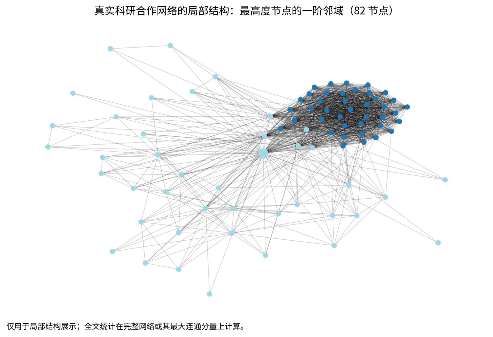
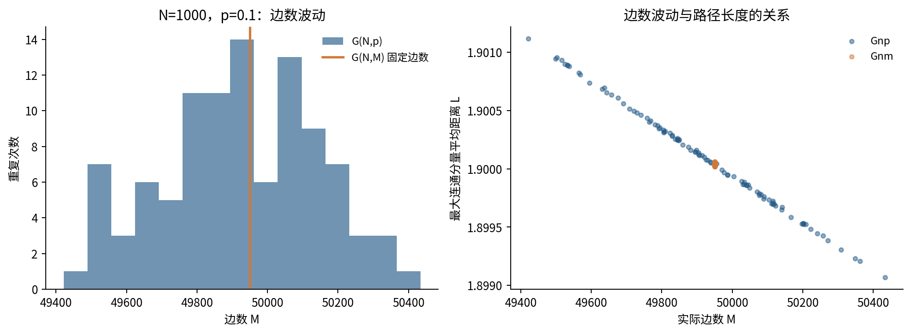
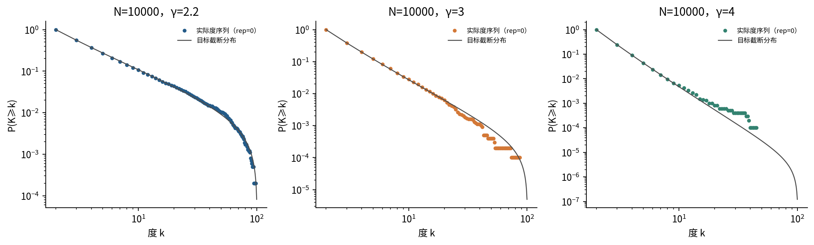
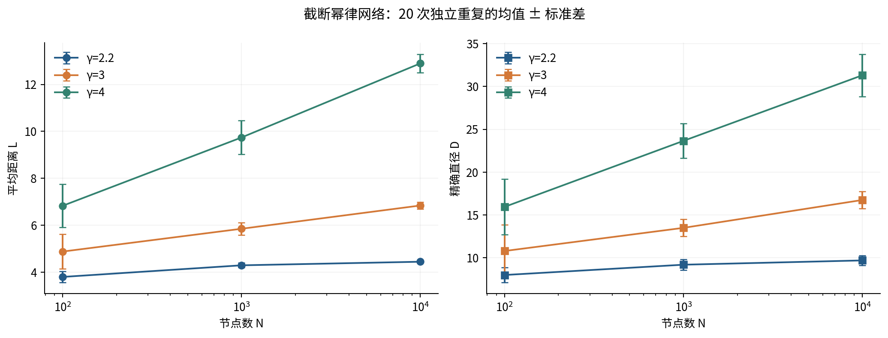
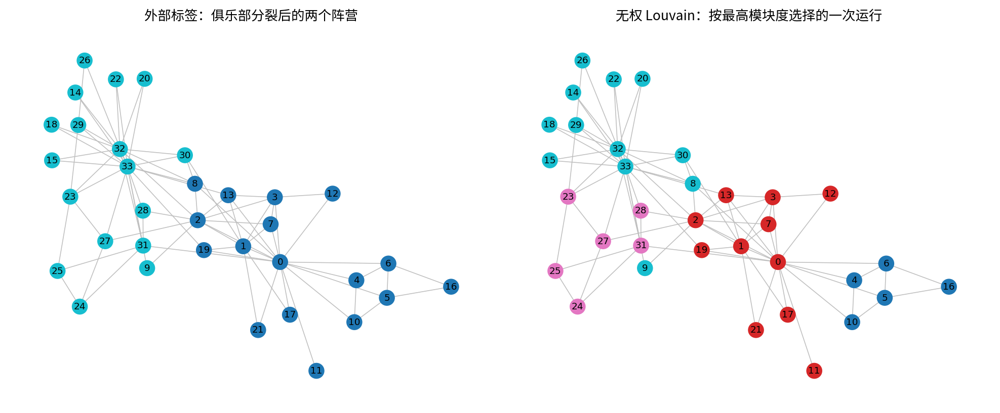

# 已保存结果与报告说明

本页与报告采用相同的实验 CSV 和九张结果图。报告正文仅列算法伪代码，完整实现见 [scripts/run_experiments.py](scripts/run_experiments.py)，运行入口及实验安排见 [README.md](README.md)。逐次实验数据保存在 [results/](results/)，原始数据的下载与预处理见 [DATA_SOURCES.md](DATA_SOURCES.md)。

平均距离 $L_H$ 和直径 $D_H$ 在最大连通分量上精确计算。$C$ 表示完整图的平均局部聚类系数，$C_H$ 表示最大分量内的同一指标。随机实验的“均值 ± 标准差”来自不同图样本，均值的近似 95% 置信区间半宽另保存在汇总 CSV 中。

## 第 2 题：科研合作网络与真实数据

ca-GrQc 以作者为节点、共同署名为边；email-Eu-core 以匿名机构成员为节点，将任一方向的邮件联系合并为无向边。两图均删除自环并保留全部节点，具体口径见数据说明 [D1, D2]。

| network       |    n |     m |   n_lcc |   m_lcc |   avg_path |   diameter |   clustering |
|:--------------|-----:|------:|--------:|--------:|-----------:|-----------:|-------------:|
| ca-GrQc       | 5242 | 14484 |    4158 |   13422 |     6.0494 |         17 |       0.5296 |
| email-Eu-core | 1005 | 16064 |     986 |   16064 |     2.5869 |          7 |       0.3994 |

ca-GrQc 的平均度为 5.526，最大度为 81，最大分量覆盖 79.32% 的节点。约两成作者不在最大合作群体中，因此表中的路径指标只描述该分量。

图 1　最高度作者及其一阶邻居构成的 82 节点诱导子图，颜色表示子图的 Louvain 社区。中心节点与其余 81 个节点均相连，图中结构受邻域选取方式影响，不能据此推断全网社区比例。

多人论文投影到作者网络时会产生完全子图，是高聚类的一种来源。现有边表没有逐篇论文的作者名单，无法区分论文投影与后续合作选择各自的作用。

## 第 4 题：两种 ER 模型

$G(N,p)$ 对每对节点独立连边；$G(N,M)$ 从全部可能边中等概率选定 $M$ 条。设 $S=\binom N2$，前者边数的均值为 $Sp$、方差为 $Sp(1-p)$，后者边数方差为零。给定 $G(N,p)$ 的实际边数为 $M$，其条件分布就是 $G(N,M)$。

四组参数、两种模型各重复 100 次，共 800 张图。固定边数取 $M=\lfloor Sp+0.5\rfloor$；$N=100,p=0.01$ 时，取整后的 50 与 $Sp=49.5$ 相差 0.5。最小度、最大度按完整图计算。

| N    | p    | 模型   | L_H              | 最大度 k_max   | 最小度 k_min   | 直径 D_H    |
|:-----|:-----|:-------|:-----------------|:---------------|:---------------|:------------|
| 100  | 0.01 | G(N,M) | 4.266 ± 0.896    | 4.21 ± 0.74    | 0.00 ± 0.00    | 9.84 ± 2.64 |
| 100  | 0.01 | G(N,p) | 4.194 ± 1.279    | 4.11 ± 0.84    | 0.00 ± 0.00    | 9.70 ± 3.54 |
| 100  | 0.1  | G(N,M) | 2.238 ± 0.007    | 18.27 ± 1.69   | 3.38 ± 0.98    | 4.00 ± 0.00 |
| 100  | 0.1  | G(N,p) | 2.242 ± 0.037    | 18.17 ± 1.60   | 3.22 ± 1.09    | 4.00 ± 0.00 |
| 1000 | 0.01 | G(N,M) | 3.258 ± 0.002    | 21.72 ± 1.49   | 1.67 ± 0.67    | 5.37 ± 0.49 |
| 1000 | 0.01 | G(N,p) | 3.257 ± 0.017    | 21.38 ± 1.54   | 1.67 ± 0.67    | 5.38 ± 0.49 |
| 1000 | 0.1  | G(N,M) | 1.900 ± 9.30e-06 | 131.63 ± 3.03  | 70.90 ± 2.78   | 3.00 ± 0.00 |
| 1000 | 0.1  | G(N,p) | 1.900 ± 4.51e-04 | 131.49 ± 3.31  | 70.67 ± 3.10   | 3.00 ± 0.00 |

| N    | p    | 模型   | 边数 M            | 最大分量占比   | 整图连通次数/100   | 平均孤立点数   |
|:-----|:-----|:-------|:------------------|:---------------|:-------------------|:---------------|
| 100  | 0.01 | Gnm    | 50.00 ± 0.00      | 0.19780        | 0/100              | 36.59          |
| 100  | 0.01 | Gnp    | 50.15 ± 7.88      | 0.20010        | 0/100              | 36.20          |
| 100  | 0.1  | Gnm    | 495.00 ± 0.00     | 1.00000        | 100/100            | 0.00           |
| 100  | 0.1  | Gnp    | 493.73 ± 22.07    | 0.99990        | 99/100             | 0.01           |
| 1000 | 0.01 | Gnm    | 4995.00 ± 0.00    | 0.99995        | 95/100             | 0.05           |
| 1000 | 0.01 | Gnp    | 4997.90 ± 66.94   | 0.99996        | 96/100             | 0.04           |
| 1000 | 0.1  | Gnm    | 49950.00 ± 0.00   | 1.00000        | 100/100            | 0.00           |
| 1000 | 0.1  | Gnp    | 49917.75 ± 222.49 | 1.00000        | 100/100            | 0.00           |

图 2　$N=1000,p=0.1$ 时的边数分布，以及实际边数与平均距离的关系。

这一组的两种模型平均距离分别为 1.90010 和 1.90004，重复间标准差分别为 4.51e-04 和 9.30e-06。固定边数主要压缩了波动范围。$N=100,p=0.01$ 接近巨型分量出现的阈值，100 次运行均不连通，最大分量平均仅约占五分之一；有限的 $L_H$ 不能解释为整张图的平均距离。

原始记录：[逐次数据](results/q4_er_replicates.csv)、[汇总](results/q4_er_summary.csv)。

## 第 5 题：截断幂律图与真实网络

### 生成与度分布检查

在 $N=100,1000,10000$、$\gamma=2.2,3,4$ 下，按 $P_N(k)\propto k^{-\gamma}$ 采样，支持范围为 $2\le k\le\lfloor\sqrt N\rfloor$。拒绝不满足偶数和或可图性条件的样本，用 Havel–Hakimi 构造简单图，再执行 $20m$ 次成功双边交换。每组重复 20 次，共 180 张图，逐节点度数均保留。

有限步换边没有严格的混合保证，拒绝采样也筛选了度样本。指数估计使用相同有限支持，经验 CDF 差是生成结果检查，不是检验 $p$ 值。

| N     | 目标 γ   | 截断上限   | 估计 γ        | 经验—目标 CDF 最大差   |
|:------|:---------|:-----------|:--------------|:-----------------------|
| 100   | 2.2      | 10         | 2.104 ± 0.257 | 0.069 ± 0.028          |
| 100   | 3.0      | 10         | 3.023 ± 0.346 | 0.055 ± 0.025          |
| 100   | 4.0      | 10         | 4.079 ± 0.261 | 0.031 ± 0.014          |
| 1000  | 2.2      | 31         | 2.191 ± 0.061 | 0.021 ± 0.007          |
| 1000  | 3.0      | 31         | 2.989 ± 0.070 | 0.016 ± 0.007          |
| 1000  | 4.0      | 31         | 4.003 ± 0.132 | 0.013 ± 0.009          |
| 10000 | 2.2      | 100        | 2.201 ± 0.020 | 0.008 ± 0.004          |
| 10000 | 3.0      | 100        | 3.003 ± 0.022 | 0.006 ± 0.003          |
| 10000 | 4.0      | 100        | 3.994 ± 0.036 | 0.005 ± 0.002          |

图 3　$N=10000$ 时第 0 次重复的经验 CCDF 与目标分布；表格使用全部 20 次重复。

### 平均距离与直径

| N     | γ   | 平均度        | L_H            | 精确 D_H     | C                   | 最大分量比例   |
|:------|:----|:--------------|:---------------|:-------------|:--------------------|:---------------|
| 100   | 2.2 | 3.442 ± 0.245 | 3.797 ± 0.231  | 8.00 ± 0.86  | 0.0437 ± 0.0200     | 1.00000        |
| 100   | 3.0 | 2.795 ± 0.183 | 4.878 ± 0.741  | 10.80 ± 3.05 | 0.0242 ± 0.0193     | 1.00000        |
| 100   | 4.0 | 2.394 ± 0.070 | 6.829 ± 0.927  | 15.95 ± 3.24 | 0.0179 ± 0.0133     | 0.99850        |
| 1000  | 2.2 | 4.381 ± 0.168 | 4.292 ± 0.099  | 9.20 ± 0.62  | 0.0134 ± 0.0039     | 1.00000        |
| 1000  | 3.0 | 3.067 ± 0.077 | 5.849 ± 0.262  | 13.50 ± 1.00 | 0.0049 ± 0.0023     | 0.99965        |
| 1000  | 4.0 | 2.452 ± 0.044 | 9.740 ± 0.717  | 23.65 ± 2.03 | 0.0017 ± 0.0019     | 0.99950        |
| 10000 | 2.2 | 5.356 ± 0.105 | 4.445 ± 0.045  | 9.70 ± 0.57  | 0.0057 ± 6.31e-04   | 1.00000        |
| 10000 | 3.0 | 3.141 ± 0.029 | 6.841 ± 0.151  | 16.75 ± 1.02 | 0.0012 ± 4.52e-04   | 1.00000        |
| 10000 | 4.0 | 2.454 ± 0.012 | 12.898 ± 0.396 | 31.30 ± 2.47 | 2.05e-04 ± 2.23e-04 | 0.99989        |

图 4　平均距离与精确直径的均值，误差棒为标准差。

$N=10000$ 时，$\gamma=2.2$ 组的平均距离为 4.445、直径为 9.70；$\gamma=4$ 组分别为 12.898 和 31.30。指数与平均度共同变化，不能将全部距离差异归因于指数。只有三个规模并采用 $\sqrt N$ 截断，也不足以区分 $\log N$ 与 $\log\log N$ 的渐近规律。

### 真实度分布与保度对照

真实图采用无限支持离散幂律尾部模型。候选阈值需保留至少 100 个尾部节点、3 种不同度值，按 KS 距离选阈值并估计指数。199 次半参数自举均重新搜索阈值、拟合指数，方法见 [M1]。

| 网络          | 正度数节点   | 阈值 k0   | 尾部节点   | 指数 α   | KS     | 自举 p   |
|:--------------|:-------------|:----------|:-----------|:---------|:-------|:---------|
| ca-GrQc       | 5241         | 3         | 2929       | 2.113    | 0.0441 | 0.005    |
| email-Eu-core | 986          | 40        | 288        | 2.799    | 0.0735 | 0.005    |

图 5　整体度 CCDF 与拟合阈值以上的条件尾部。

两张图均未获本次纯幂律检验支持。0.005 是 199 次自举使用加一公式时的最小报告值，不能理解为尾概率已被精确估计。检验未充分处理节点度之间的依赖，也没有比较全部替代分布。

ca-GrQc 的平均距离为 6.049、直径为 17，两项均高于 $N=10000,\gamma=2.2$ 的合成组，数值更接近 $\gamma=3$ 组。规模、平均度、最低度和截断不同，这只能作现象比较；尾部拟合也未通过检验，当前结果不足以验证给定指数模型能解释真实图。

从各真实图的最大分量出发，分别生成 20 个保持逐节点度数和连通性的随机对照。每次进行 $20m$ 次换边尝试，成功数另存；有限步随机化没有严格的混合保证。

| 网络          | 匹配 n_H,m_H   | 真实 L_H   | 对照 L_H      | 真实 C_H   | 对照 C_H          |
|:--------------|:---------------|:-----------|:--------------|:-----------|:------------------|
| ca-GrQc       | 4158, 13422    | 6.049      | 4.074 ± 0.007 | 0.5569     | 0.0091 ± 8.23e-04 |
| email-Eu-core | 986, 16064     | 2.587      | 2.442 ± 0.006 | 0.4071     | 0.1602 ± 0.0032   |

固定作者合作数量后，随机化仍将 ca-GrQc 的聚类从约 0.557 降至 0.009，平均距离从 6.049 缩短到 4.074。具体合作对象的组织方式仍有作用。保度对照考察的是度序列以外的结构，与检验给定指数模型的拟合能力是两个问题。

数据：[幂律逐次记录](results/q5_powerlaw_replicates.csv)、[幂律汇总](results/q5_powerlaw_summary.csv)、[尾部拟合](results/q5_empirical_tail_fit.csv)、[自举记录](results/q5_empirical_tail_bootstrap.csv)、[保度对照](results/real_degree_null_replicates.csv)、[对照汇总](results/real_degree_null_summary.csv)。

## 第 6 题：WS 与小世界比较

WS 从每个节点连接左右各 $K/2$ 个邻居的规则环出发，以概率 $p$ 重连边。实验取 $K=6$、两个规模、9 个重连概率，每组重复 40 次，共 720 张图。

规则环的聚类为 $C(0)=3(K-2)/[4(K-1)]=0.6$。$N=100$ 与 $N=1000$ 的精确平均距离分别为 8.757576、83.750751，与 $p=0$ 输出一致。小 $p$ 时用 $C(p)\approx C(0)(1-p)^3$ 近似：$p=0.01$ 预测 0.5822，$N=1000$ 的模拟均值为 0.5833；$p=0.1$ 时分别为 0.4374 和 0.4432。

| N    | 重连概率 p   | L_H             | C                 | 连通次数/40   |
|:-----|:-------------|:----------------|:------------------|:--------------|
| 100  | 0.0000       | 8.758 ± 0.000   | 0.6000 ± 0.0000   | 40/40         |
| 100  | 1.00e-04     | 8.758 ± 0.000   | 0.6000 ± 0.0000   | 40/40         |
| 100  | 0.0010       | 8.505 ± 0.556   | 0.5987 ± 0.0031   | 40/40         |
| 100  | 0.0030       | 8.126 ± 0.793   | 0.5959 ± 0.0052   | 40/40         |
| 100  | 0.0100       | 6.721 ± 0.890   | 0.5864 ± 0.0078   | 40/40         |
| 100  | 0.0300       | 4.870 ± 0.448   | 0.5497 ± 0.0199   | 40/40         |
| 100  | 0.1000       | 3.663 ± 0.183   | 0.4502 ± 0.0275   | 40/40         |
| 100  | 0.3000       | 2.983 ± 0.048   | 0.2377 ± 0.0257   | 40/40         |
| 100  | 1.0000       | 2.729 ± 0.013   | 0.0534 ± 0.0103   | 40/40         |
| 1000 | 0.0000       | 83.751 ± 0.000  | 0.6000 ± 0.0000   | 40/40         |
| 1000 | 1.00e-04     | 79.988 ± 7.442  | 0.5999 ± 2.63e-04 | 40/40         |
| 1000 | 0.0010       | 55.391 ± 14.128 | 0.5981 ± 0.0013   | 40/40         |
| 1000 | 0.0030       | 30.236 ± 4.354  | 0.5942 ± 0.0018   | 40/40         |
| 1000 | 0.0100       | 16.601 ± 1.915  | 0.5833 ± 0.0033   | 40/40         |
| 1000 | 0.0300       | 9.608 ± 0.482   | 0.5505 ± 0.0056   | 40/40         |
| 1000 | 0.1000       | 6.161 ± 0.099   | 0.4432 ± 0.0083   | 40/40         |
| 1000 | 0.3000       | 4.648 ± 0.021   | 0.2105 ± 0.0076   | 40/40         |
| 1000 | 1.0000       | 4.099 ± 0.005   | 0.0049 ± 0.0011   | 40/40         |

图 6　按各自规则环结果归一化，误差棒为标准差。

$N=1000,p=0.01$ 时，$L(p)/L(0)=0.198$、$C(p)/C(0)=0.972$，少量重连明显缩短路径，同时保留大部分局部聚类。相同 $p$ 下，两个规模的绝对平均距离分别为 6.721 和 16.601。重连边数期望约为 $pNK/2$，小世界区间需要结合规模理解；$p=1$ 的 WS 图仍受构造约束，与 ER 图分布不同。

真实图复用第 5 题的保度、保连通对照，使用 [M6] 的比值形式：

$$
\sigma=\frac{C_{\mathrm{real}}/\overline C_{\mathrm{null}}}{L_{\mathrm{real}}/\overline L_{\mathrm{null}}}.
$$

原文采用 ER 对照，这里采用保度对照，因此该值只描述相对于本次基线的小世界特征。

| 网络          | C_real / C_null   | L_real / L_null   | σ     |
|:--------------|:------------------|:------------------|:------|
| ca-GrQc       | 61.40             | 1.48              | 41.35 |
| email-Eu-core | 2.54              | 1.06              | 2.40  |

两张真实图都在较短路径的同时保留高于保度对照的聚类，与 WS 实验中的小世界现象相符。ca-GrQc 的平均距离仍比对照长约一半；这些结果不能确定真实网络的生成机制就是 WS。

数据：[WS 逐次记录](results/q6_ws_replicates.csv)、[汇总](results/q6_ws_summary.csv)。

## 第 7 题：社团识别与组织标签

### 基本假设与评价

报告讨论了四组前提：社团可从链接唯一解码、社团是连通且局部稠密的子图、随机连线可作为无预设社团的零模型、最大模块度划分提供较好的结构解释。它们是识别准则的假设，是否对应真实组织需用外部信息评价。

实验采用无向、静态、非重叠的同配型社区，模块度为

$$
Q_{\rho}=\frac1{2m}\sum_{ij}\left(A_{ij}-\rho\frac{k_ik_j}{2m}\right)\mathbf1(c_i=c_j).
$$

默认 $\rho=1$，所有算法与模块度均设置 `weight=None`。ARI 调整随机一致性，NMI 使用算术归一化；部门和阵营标签只参与外部评价。代表性运行按模块度选择，不按 ARI 或 NMI 选取。

### 算法与结果

Louvain [M3] 通过局部移动和社区压缩优化模块度；贪心模块度逐步合并社区；异步标签传播按邻居标签频数迭代。Louvain 与标签传播各运行 30 个种子，贪心算法对固定图运行一次。

Girvan-Newman 反复删除高边介数边，仅在 34 节点的 Karate 网络 [D3] 上运行。记录社区数为 2 至 10 的层次，按原图模块度选择最佳层，第一次二分另行保留。

| 网络/范围    | 算法          | 运行数   | 社区数      | 标准模块度 Q    | ARI             | NMI             |
|:-------------|:--------------|:---------|:------------|:----------------|:----------------|:----------------|
| Karate 全图  | Girvan-Newman | 1        | 5.00        | 0.4013          | 0.3916          | 0.4851          |
| Karate 全图  | Greedy        | 1        | 3.00        | 0.3807          | 0.5684          | 0.5646          |
| Karate 全图  | LPA           | 30       | 3.47 ± 0.97 | 0.3278 ± 0.1057 | 0.4661 ± 0.2361 | 0.4950 ± 0.1772 |
| Karate 全图  | Louvain       | 30       | 4.00 ± 0.00 | 0.4164 ± 0.0061 | 0.4446 ± 0.0448 | 0.5459 ± 0.0509 |
| 邮件最大分量 | Greedy        | 1        | 8.00        | 0.3471          | 0.1535          | 0.4273          |
| 邮件最大分量 | LPA           | 30       | 1.20 ± 0.41 | 0.0159 ± 0.0323 | 0.0018 ± 0.0037 | 0.0243 ± 0.0495 |
| 邮件最大分量 | Louvain       | 30       | 7.63 ± 0.56 | 0.4134 ± 0.0029 | 0.3021 ± 0.0282 | 0.5761 ± 0.0140 |

Karate 的第一次二分为 $Q=0.3600$、ARI=0.7717；按模块度选出的 5 组划分为 $Q=0.4013$、ARI=0.3916。按模块度选层会舍弃与两个实际阵营更吻合的二分结果。

图 7　实际阵营与 Louvain 分区共用布局。代表运行取最高模块度，并列时取最小重复编号。

邮件最大分量有 986 个节点，仍包含全部 42 个部门。默认 Louvain 平均划出 7.63 个社区，ARI 为 0.3021；标签传播平均得到 1.20 个社区，ARI 为 0.0018，许多运行将几乎整个分量合成一组。

图 8　真实部门与代表性 Louvain 分区的交叉计数。

通信社区与行政部门边界不同，跨部门联系与部门内部小组都可能影响结果，匿名边表无法逐项确认。无向处理舍弃方向，原始边表也没有频率信息。

### 分辨率扫描

邮件网络另取 $\rho=0.5,1,1.5,2,3$，每组运行 10 个种子。表中标准模块度统一按 $\rho=1$ 评价，优化时使用各行设定的分辨率。

| 分辨率 ρ   | 社区数       | 标准模块度 Q₁   | ARI             | NMI             |
|:-----------|:-------------|:----------------|:----------------|:----------------|
| 0.5        | 3.10 ± 0.32  | 0.2492 ± 0.0200 | 0.0608 ± 0.0085 | 0.3108 ± 0.0213 |
| 1.0        | 7.40 ± 0.52  | 0.4140 ± 0.0016 | 0.3063 ± 0.0359 | 0.5734 ± 0.0174 |
| 1.5        | 14.50 ± 0.71 | 0.3993 ± 0.0034 | 0.4906 ± 0.0089 | 0.6615 ± 0.0071 |
| 2.0        | 24.30 ± 1.06 | 0.3819 ± 0.0017 | 0.5548 ± 0.0194 | 0.7063 ± 0.0067 |
| 3.0        | 40.60 ± 1.58 | 0.3541 ± 0.0025 | 0.5978 ± 0.0198 | 0.7369 ± 0.0056 |

图 9　分辨率与社区数、ARI、NMI 的关系，误差棒为标准差。

$\rho=3$ 时平均有 40.6 个社区，接近 42 个部门，ARI 约为 0.60，成员归属仍有差异。这组扫描用于观察参数影响，主比较采用默认 $\rho=1$。

数据：[社团逐次结果](results/q7_community_replicates.csv)、[节点划分](results/q7_assignments.csv)、[GN 层次](results/q7_gn_hierarchy.csv)、[分辨率汇总](results/q7_resolution_summary.csv)。

## 参考文献与数据

[D1] Stanford SNAP. *General Relativity and Quantum Cosmology collaboration network*. [说明及下载](https://snap.stanford.edu/data/ca-GrQc.html)。该条目引用 Leskovec, Kleinberg, Faloutsos, *Graph Evolution: Densification and Shrinking Diameters*, ACM TKDD, 2007。

[D2] Stanford SNAP. *email-Eu-core network*. [邮件边表及部门标签](https://snap.stanford.edu/data/email-Eu-core.html)。数据条目引用 Yin, Benson, Leskovec, Gleich, *Local Higher-order Graph Clustering*, KDD, 2017。

[D3] Zachary, W. W. *An Information Flow Model for Conflict and Fission in Small Groups*. Journal of Anthropological Research, 33: 452–473, 1977。使用 [NetworkX 提供的图及阵营标签](https://networkx.org/documentation/stable/reference/generated/networkx.generators.social.karate_club_graph.html)。

[M1] Clauset, A., Shalizi, C. R., Newman, M. E. J. *Power-law Distributions in Empirical Data*. SIAM Review, 51: 661–703, 2009。[论文](https://arxiv.org/abs/0706.1062)。

[M2] Watts, D. J., Strogatz, S. H. *Collective Dynamics of ‘Small-world’ Networks*. Nature, 393: 440–442, 1998。[DOI](https://doi.org/10.1038/30918)。

[M3] Blondel, V. D., Guillaume, J.-L., Lambiotte, R., Lefebvre, E. *Fast Unfolding of Communities in Large Networks*. J. Stat. Mech., P10008, 2008。[论文](https://arxiv.org/abs/0803.0476)。

[M6] Humphries, M. D., Gurney, K. *Network “Small-World-Ness”: A Quantitative Method for Determining Canonical Network Equivalence*. PLOS ONE, 3(4): e0002051, 2008。[论文](https://doi.org/10.1371/journal.pone.0002051)。
